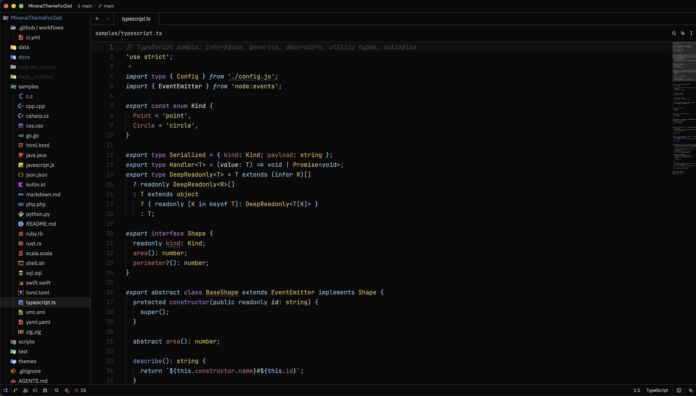

# My Dark Theme for Zed

A dark theme family for [Zed](https://zed.dev) with **10 background variants**, each shipped in a normal and a high-contrast flavor — **20 themes** in a single family. Syntax colors are built on the classic open Material palette, with per-variant desaturation, per-variant terminal ANSI colors, and an accent that stays consistent across every surface.



## Themes

| Variant | Editor background | Variant | Editor background |
|---|---|---|---|
| Carbon | `#0A0A0A` | Ocean | `#0F111A` |
| Anthracite | `#151719` | Palenight | `#232634` |
| Clay | `#1B1818` | Sand | `#131210` |
| Deepforest | `#111816` | Teal | `#263238` |
| Graphene | `#212121` | Montana | `#130F15` |

Every variant also has a **High Contrast** edition (e.g. *My Dark Theme Carbon High Contrast*) with lifted editor backgrounds and contrast-tuned UI colors. Themes appear in the picker as one family: **My Dark Theme**.

## Design notes

- **Syntax highlighting is mapped per Tree-sitter capture**, not per TextMate scope: declaration keywords (purple), control flow (cyan italic), types (yellow), functions (blue), properties/members (red), strings (green), numbers (orange), comments (gray italic).
- **Italic support** for comments, doc comments, control keywords, imports and markup — use a font with real italics (e.g. JetBrains Mono) for the intended look.
- **The accent is baked in as blue `#5393FF`** and drives `text.accent`, `icon.accent`, links, active-element tints and the active search match. It is a static theme — Zed themes have no runtime — so the accent can be changed per theme via Zed's `theme_overrides` (below) or at build time.
- Terminal colors are a full per-variant ANSI palette (normal / bright / synthesized dim rows).
- UI colors were translated key-by-key from the VS Code original (~140 Zed style keys, coverage-tested), including git decorations, diff highlights, scrollbar, search matches and editor document highlights.

## Installation

### From a downloaded bundle (CI artifact)

Every CI run attaches a ready-to-use bundle (`extension.toml` + generated `themes/`):

1. Download the `my-dark-theme-zed-<version>.zip` artifact from the latest CI run.
2. Unzip it anywhere.
3. In Zed: open the Extensions page (`zed: extensions`) → **Install Dev Extension** → select the unzipped folder.
4. Open the theme selector (`cmd-k cmd-t` / `ctrl-k ctrl-t`) and pick a variant.

> Note: Zed has no side-loadable package format (no vsix equivalent) — extensions are either loaded as dev extensions from a directory or installed from the [extension registry](https://zed.dev/extensions). The CI bundle is exactly that directory, zipped.

### As a dev extension (from source)

```bash
git clone <this repository>
cd MyDarkThemeForZed
npm install
npm run build        # generates themes/my-dark-theme.json
```

Then **Install Dev Extension** in Zed and select the repository root (the folder containing `extension.toml`).

## Changing the accent color

The baked accent can be overridden two ways:

**Per theme, in Zed settings** (works everywhere, no rebuild):

```json
{
  "theme_overrides": {
    "My Dark Theme Carbon": {
      "text.accent": "#FF669Eff",
      "icon.accent": "#FF669Eff",
      "link_text.hover": "#FF669Eff",
      "element.active": "#FF669E26"
    }
  }
}
```

**At build time** (regenerates the whole family with another accent):

```bash
npx tsx scripts/build-themes.ts --accent=pink   # 14 preset names or any #hex
```

## Development

The repository root is the extension root. `themes/my-dark-theme.json` is **generated** — edit `data/` and the mapping tables in `scripts/`, never the output.

```
extension.toml            Zed extension manifest (id: my-dark-theme)
themes/                   generated theme family (single file, 20 themes)
data/                     color source of truth (palettes, per-variant UI colors, HC overrides, accent spec)
scripts/ui-map.ts         VS Code → Zed UI color mapping (all 139 One-theme keys, coverage-tested)
scripts/syntax-map.ts     syntax keys → palette roles (46 canonical keys + 7 extras)
scripts/build-themes.ts   builder + JSON Schema validation + accent baking
test/                     vitest: schema, determinism, palette, accent, HC assertions
```

Commands:

```bash
npm run verify    # typecheck + build (ajv schema validation) + 36 tests
npm run build     # themes only
npm test          # assertions only
```

The build is deterministic (byte-identical output for identical input) and validates against the [official Zed theme JSON schema](https://zed.dev/schema/themes/v0.2.0.json). CI runs the full pipeline and repackages the downloadable bundle on every push.

## Publishing

This extension is intended for the [Zed extension registry](https://zed.dev/extensions). Publishing requirements are already accounted for in the design: theme-only extension (no Rust), registry-friendly id (`my-dark-theme`), English description, and a single generated theme file. The remaining steps live in [PROGRESS.md](PROGRESS.md): public repository, MIT license, `repository` field in `extension.toml`, then a PR to `zed-industries/extensions` (git submodule + `extensions.toml` entry).

## Development Agent

This extension was built end-to-end with the **ZCode** coding agent, powered by **GLM-5.3-Flash** (Z.ai) — research, milestone planning, the data pipeline and mapping tables, the 20 generated themes, the test suite, pixel-level rendering comparisons between VS Code and Zed, and these very docs. Human review covered every decision that mattered: naming, accent color, scope, and whether to publish.

## Acknowledgments

- Color values derive from the author's VS Code theme of the same name, built on the open **Material color palette** (as popularized by Material Theme and Vira Theme).
- The syntax key set follows the conventions of Zed's built-in **One** theme; the theme format targets the [official Theme JSON Schema v0.2.0](https://zed.dev/schema/themes/v0.2.0.json).

## License

This repository is currently private and for personal use. It will be released under the **MIT License** when published to the extension registry (a registry requirement); see [LICENSE.txt](LICENSE.txt) in the meantime.

中文说明见 [README_zh.md](README_zh.md)。
